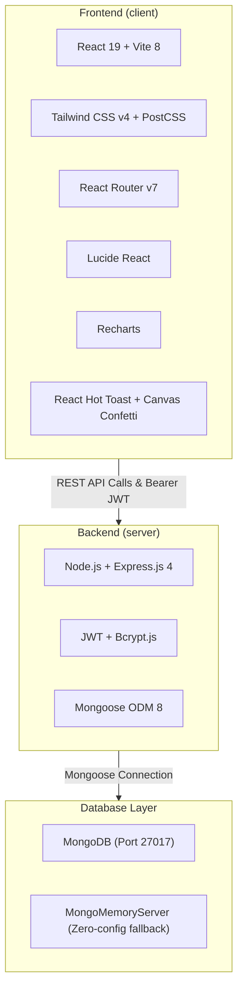
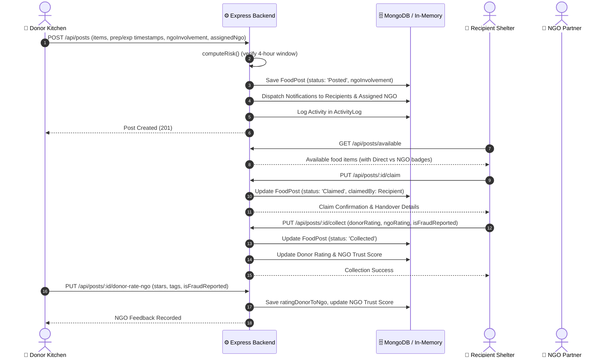

# Food Rescue Hub (ZeroWaste) — Comprehensive Technical & Functional Guide

## 1. System Overview
**Food Rescue Hub (ZeroWaste)** is a real-time surplus food redistribution web platform built to combat food waste and food insecurity. It bridges commercial food donors (restaurants, caterers, mess halls, bakeries) directly with vetted recipient shelters, orphanages, old-age homes, and NGO/volunteer distribution networks before surplus food expires.

---

## 2. Role-Based Feature Breakdown

### 🍲 Donor Features
*Implemented in [DonorDashboard.jsx](file:///d:/CSP/Application/client/src/pages/DonorDashboard.jsx), [PostFoodModal.jsx](file:///d:/CSP/Application/client/src/components/PostFoodModal.jsx), and [RateNgoModal.jsx](file:///d:/CSP/Application/client/src/components/RateNgoModal.jsx)*

- **Surplus Food Listing Form**:
  - Donors post multi-item donation manifests (name, quantity, unit: kg, L, portions, boxes, category: Cooked Meal, Bakery, Raw Groceries, Dairy).
  - Quick-preset chips for rapid entry during kitchen closing hours.
  - Image attachment and dietary categorization (`Veg`, `Non-Veg`, `Vegan`).
  - Storage temperature notes (e.g., *“Kept hot in insulated containers > 60°C”*).
- **Flexible NGO Involvement & Direct Routing**:
  - **🚀 Direct to Recipient (Recommended)**: Donors can route surplus directly to verified shelters and care homes without unnecessary NGO intermediary delays.
  - **🛡️ Involve Verified NGO Partner**: For bulk donations (>20 kg), donors can opt-in to involve a vetted NGO partner with thermal transport vans.
  - Donors review NGO credentials, trust scores (e.g. 98% Legit), and verified badges prior to selection.
- **Donor Feedback & Anti-Fraud Ratings on NGOs**:
  - When an NGO handles logistics, donors can rate the NGO (1–5 stars) and select audit tags (*"On-Time Logistics"*, *"Hygienic Transit"*, *"Transparent"*).
  - Anti-Fraud Flagging: Donors can report suspected NGO misconduct (e.g., driver arrived late, no thermal boxes, or demanded payment). Submitting a fraud report deducts 25 trust points and alerts network auditors.
- **Automated Food Safety Verification**:
  - Preparation and expiry timestamps enforced via FSSAI & WHO-aligned 4-Hour Rule.
  - Integrated [FoodSafetyModal.jsx](file:///d:/CSP/Application/client/src/components/FoodSafetyModal.jsx) guidelines.
- **Dynamic Risk Evaluation**:
  - Live client & server-side risk computation preventing high-risk (spoiled/unsafe) food submissions.
- **Listing & Pickup Status Tracking**:
  - Live status tracking across the lifecycle: `Posted` ➔ `Claimed` ➔ `Collected` (or `Expired` / `Cancelled`).
  - Visual status timeline displaying recipient details, pickup contact, and assigned NGO partner.
- **Impact Analytics & Badges**:
  - Donors track total kilograms rescued, meal portions created, and their achievement badge rank (`Bronze`, `Silver`, `Gold`).

---

### 🤝 Receiver / Recipient Features (Shelters & Care Homes)
*Implemented in [RecipientDashboard.jsx](file:///d:/CSP/Application/client/src/pages/RecipientDashboard.jsx), [ClaimConfirmationModal.jsx](file:///d:/CSP/Application/client/src/components/ClaimConfirmationModal.jsx), [MarkCollectedModal.jsx](file:///d:/CSP/Application/client/src/components/MarkCollectedModal.jsx), and [RateNgoModal.jsx](file:///d:/CSP/Application/client/src/components/RateNgoModal.jsx)*

- **Live Surplus Food Discovery Feed**:
  - Real-time feed of available surplus food with multi-criteria filtering by dietary preference, category, and risk level.
  - Clear routing indicator: shows whether the item is available for Direct Kitchen Pickup or transported via Verified NGO Partner.
  - Full donor profile visibility: organization type, rating stars, phone contact, and pickup address.
- **Interactive Proximity Map**:
  - SVG radar map visualization displaying donor locations and distances relative to the care center.
- **1-Click Food Claiming**:
  - Modal reservation system with celebratory confetti feedback via `canvas-confetti`. Locks the donation to prevent double-claiming.
- **Collection Confirmation & Double-Sided Reviews**:
  - **Donor Review**: Recipient rates donor food quality (1–5 stars) and adds compliment tags (*"Hot & Fresh"*, *"Hygienic Packaging"*).
  - **NGO Delivery & Anti-Fraud Review**: If an NGO transported the food, recipient rates the NGO delivery (1–5 stars) and verifies quantity accuracy (*"Full Quantity Received"*, *"Delivered Sealed"*, *"Courteous Staff"*).
  - **Fraud Detection Check**: Recipients can report fraudulent NGOs that diverted food, damaged containers, or demanded illicit fees, immediately triggering network administrative action.
- **Real-Time Notification Bell**:
  - In-app notification alerts whenever fresh surplus food is posted in their area.

---

### 🚴 Volunteer & NGO Operational Features
*Implemented across [NgoDashboard.jsx](file:///d:/CSP/Application/client/src/pages/NgoDashboard.jsx), [MonitoringPage.jsx](file:///d:/CSP/Application/client/src/pages/MonitoringPage.jsx), and [RecipientDashboard.jsx](file:///d:/CSP/Application/client/src/pages/RecipientDashboard.jsx)*

- **Assigned Donation Pickup Logistics**:
  - Direct access to donor kitchen locations, pickup timing windows, and shelter delivery coordinates.
- **Safety Protocol Adherence**:
  - Enforced thermal container verification and hygienic transit checklists.
- **Trust Score Transparency**:
  - Transparent public Trust Score (0–100%) computed dynamically from verified handovers and audit ratings from both donors and care shelters.
- **Handover Verification**:
  - Real-time logging of handovers in the chronological [ActivityLog.js](file:///d:/CSP/Application/server/src/models/ActivityLog.js).

---

### 🛡️ Admin & NGO Network Oversight Features
*Implemented in [NgoDashboard.jsx](file:///d:/CSP/Application/client/src/pages/NgoDashboard.jsx), [MonitoringPage.jsx](file:///d:/CSP/Application/client/src/pages/MonitoringPage.jsx), and [DbViewPage.jsx](file:///d:/CSP/Application/client/src/pages/DbViewPage.jsx)*

- **City-Wide Network Monitoring**:
  - Real-time KPI counters: total donations, active posts, claimed posts, completed rescues, verified donors, and partner shelters.
  - Live data table auto-refreshing every 5 seconds.
- **NGO Trust & Anti-Fraud Network Monitor**:
  - Live dashboard tracking all registered NGOs, their trust scores (e.g. 98% Legit), ratings, and active fraud/misconduct report counts.
  - Automatic trust score penalty (-25 points) and badge demotion if fraud or food diversion is reported.
- **Audit Register with Distribution Routing**:
  - Full inspection table displaying whether donations were routed Direct or via NGO Partner, with fraud flags prominently highlighted.
- **Public Impact & Leaderboard**:
  - [ImpactPage.jsx](file:///d:/CSP/Application/client/src/pages/ImpactPage.jsx) featuring trend area charts.
  - [LeaderboardPage.jsx](file:///d:/CSP/Application/client/src/pages/LeaderboardPage.jsx) showcasing top donor kitchens.

---

## 3. Current Implementation vs. Future Roadmap

| Area | Currently Implemented in Application | Planned Future Additions |
| :--- | :--- | :--- |
| **Authentication & RBAC** | JWT authentication with role authorization (`donor`, `recipient`, `ngo`), password hashing via `bcryptjs`, and instant demo login switcher. | Multi-factor authentication (MFA/OTP), OAuth2 (Google login), and custom sub-roles (e.g., *Kitchen Chef*, *Shelter Admin*). |
| **NGO Anti-Fraud & Routing** | Donor choice of Direct Delivery vs. Verified NGO Partner, dual-sided donor & recipient NGO reviews, dynamic Trust Score, and automated fraud penalties. | GPS driver geofencing, QR-code cryptographic handover scanning, and government NGO portal API integration. |
| **Food Safety Engine** | Dynamic [computeRisk](file:///d:/CSP/Application/server/src/routes/postRoutes.js#L10-L43) algorithm based on prep/expiry timestamps, quality check flags, and automatic background expiration. | IoT temperature sensor integration (Bluetooth/Wi-Fi probes) and AI image freshness classification via computer vision. |
| **Mapping & Logistics** | Simulated radar proximity map ([InteractiveMap.jsx](file:///d:/CSP/Application/client/src/components/InteractiveMap.jsx)) with donor pins and claim modals. | Live Google Maps / OpenStreetMap integration with turn-by-turn routing, GPS courier live tracking, and route batching. |
| **Notifications** | In-app notification bell with unread badges and auto-polling in [NotificationDropdown.jsx](file:///d:/CSP/Application/client/src/components/NotificationDropdown.jsx). | WebSockets (Socket.io) for instant push alerts, SMS alerts (Twilio), and automated WhatsApp dispatch messages. |
| **Carbon & ESG Metrics** | Rescued food weight (kg) and meal count metrics. | Verified CO₂ emission reduction certification, ESG exportable reporting for corporate donor tax credits. |

---

## 4. Technology Stack & Packages Used

### Frontend Stack (`client/`)
- **Core Framework**: React `19.2.8` with Vite `8.3.0` build tooling.
- **Routing**: `react-router-dom` `7.18.4`.
- **Styling**: Tailwind CSS `4.3.3` with `@tailwindcss/postcss`.
- **Data Visualization**: `recharts` `3.10.1` (interactive area charts, gradients, and Cartesian grids).
- **Icons**: `lucide-react` `1.54.0`.
- **Feedback & Delight**: `react-hot-toast` `2.6.1` and `canvas-confetti` `1.9.4`.
- **Motion**: `framer-motion` `14.0.0`.
- **Linter**: `oxlint` `1.81.0`.

### Backend Stack (`server/`)
- **Runtime & Web Framework**: Node.js (ES Modules `type: "module"`), Express.js `4.19.2`.
- **Security & Cryptography**: `jsonwebtoken` `9.0.2` and `bcryptjs` `2.4.3`.
- **Database & Modeling**: `mongoose` `8.3.1`.
- **Zero-Config Database Engine**: `mongodb-memory-server` `9.2.0` (in-memory MongoDB engine fallback if no local MongoDB instance is running).
- **Utilities**: `cors` `2.8.5` and `dotenv` `16.4.5`.

---

## 5. System Architecture & Operational Workflow

### Architectural Pattern
The application follows a **Decoupled 3-Tier REST Architecture**:
1. **Client Tier**: Single Page Application (SPA) with Context API state management ([AuthContext.jsx](file:///d:/CSP/Application/client/src/context/AuthContext.jsx), [NotificationContext.jsx](file:///d:/CSP/Application/client/src/context/NotificationContext.jsx)).
2. **API & Logic Tier**: Express router controllers, JWT authorization middleware ([auth.js](file:///d:/CSP/Application/server/src/middleware/auth.js)), and business rules for food safety and anti-fraud auditing.
3. **Data Tier**: Mongoose schemas enforcing constraints on Users, FoodPosts, Notifications, and ActivityLogs.

### End-to-End Operational Lifecycle with Anti-Fraud Checks

---

## 6. Comprehensive API Reference

### 🔐 Authentication (`/api/auth`)
| Method | Endpoint | Auth Required | Description |
| :--- | :--- | :---: | :--- |
| `POST` | `/api/auth/register` | No | Creates a new user account with assigned role (`donor`, `recipient`, `ngo`). |
| `POST` | `/api/auth/login` | No | Validates credentials and returns a signed 7-day JWT token with user metadata. |
| `GET` | `/api/auth/me` | Bearer Token | Returns current authenticated user profile. |

### 🍱 Food Posts & Management (`/api/posts`)
| Method | Endpoint | Auth Required | Description |
| :--- | :--- | :---: | :--- |
| `GET` | `/api/posts/ngos` | No | Lists verified NGOs with trust scores and fraud reports count for donor selection. |
| `POST` | `/api/posts` | Bearer (Donor) | Submits a food surplus post with optional NGO involvement; calculates risk level; notifies recipients. |
| `GET` | `/api/posts/available` | No | Lists all active unexpired posts with status `Posted` and distribution badges. |
| `GET` | `/api/posts/my-posts` | Bearer (Donor) | Returns all posts created by the logged-in donor with NGO status and feedback options. |
| `GET` | `/api/posts/my-claims` | Bearer (Recipient) | Returns all posts claimed by the logged-in recipient with NGO delivery indicators. |
| `PUT` | `/api/posts/:id/claim` | Bearer (Recipient) | Claims an available post for pickup. |
| `PUT` | `/api/posts/:id/collect` | Bearer Token | Marks item collected, updates donor rating, and saves recipient feedback on involved NGO. |
| `PUT` | `/api/posts/:id/donor-rate-ngo` | Bearer (Donor) | Donor rates the involved NGO and reports any suspected misconduct or fraud. |
| `PUT` | `/api/posts/:id/recipient-rate-ngo` | Bearer (Recipient) | Recipient rates the involved NGO delivery and reports quantity discrepancy/fraud. |
| `PUT` | `/api/posts/:id/cancel` | Bearer (Donor) | Cancels an uncollected food listing. |

### 🔔 Notifications (`/api/notifications`)
| Method | Endpoint | Auth Required | Description |
| :--- | :--- | :---: | :--- |
| `GET` | `/api/notifications` | Bearer Token | Retrieves notifications for the user with unread count. |
| `PUT` | `/api/notifications/mark-read` | Bearer Token | Marks specific or all notifications as read. |

### 📊 Statistics & Impact (`/api/stats`)
| Method | Endpoint | Auth Required | Description |
| :--- | :--- | :---: | :--- |
| `GET` | `/api/stats` | No | Returns platform-wide KPIs (kg rescued, meals served), donor leaderboard rankings, and 7-day trends. |

### 🔍 Monitoring & Evaluation (`/api/monitoring` & `/api/db-view`)
| Method | Endpoint | Auth Required | Description |
| :--- | :--- | :---: | :--- |
| `GET` | `/api/monitoring` | No / NGO | Detailed operational data table, NGO anti-fraud audit data, sentiment scores, and recent audit logs. |
| `POST` | `/api/monitoring/seed` | No | Resets database collections and populates fresh sample data with anti-fraud ratings. |
| `GET` | `/api/db-view` | No | Raw collection view for evaluators (Users, FoodPosts, Notifications, Logs). |
| `POST` | `/api/db-view/simulate-post` | No | Injects a simulated live donor post to demonstrate real-time feed updates. |
| `POST` | `/api/db-view/simulate-claim` | No | Injects a simulated live recipient claim. |
| `GET` | `/api/health` | No | Health check returning service status and timestamp. |